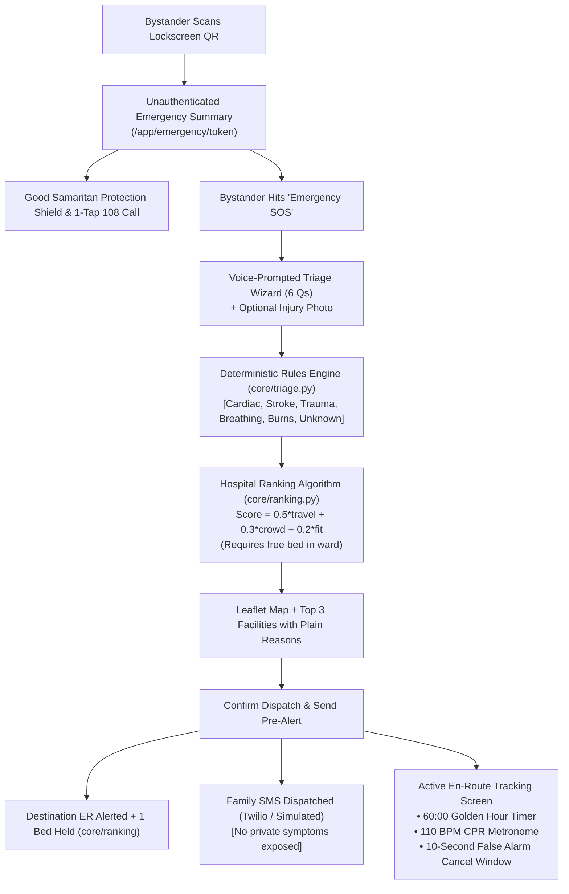
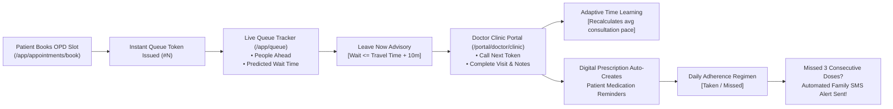

# 🚑 E-Doot: Emergency-First Healthcare Network

> **Emergency-first healthcare application with an outpatient daily-use retention engine.**  
> Built for the Indian healthcare landscape with zero-Aadhaar authentication, Good Samaritan legal protection, deterministic triage, dynamic bed-aware hospital routing, and Google Gemini AI health guidance.

---

## ⚡ 1-Click Launch (Windows)

Simply double-click the **`START.bat`** (or `start.bat`) file in this folder:
- Automatically verifies your Python environment and installs dependencies.
- Seeds the 8 Delhi/NCR network hospitals and 3 mock patient profiles if needed.
- Launches the local Flask server at `http://127.0.0.1:5000`.
- Automatically opens your default web browser to the landing page!

To reset all data to a pristine state before a demonstration, double-click **`RESET_DEMO.bat`** (or run `python seed.py`).

---

## 🌟 The Core Duality: Two Complementary Interfaces

```text
┌─────────────────────────────────────────────────────────────────────────────┐
│                                   E-DOOT                                    │
├──────────────────────────────────────┬──────────────────────────────────────┤
│    1. HERO EMERGENCY FLOW (/app)     │     2. DOCTOR & ADMIN PORTAL (/portal) │
│                                      │                                      │
│  • Lockscreen QR Code shortcut       │  • Live ER Pre-Alert Board           │
│  • Unauthenticated Bystander Access  │  • Real-Time ETA Countdown           │
│  • Good Samaritan Legal Shield       │  • 1-Click Bed Hold & Pre-Arrival    │
│  • Voice-Prompted Rules Triage (6 Qs)│  • Outpatient Clinic Queue Controls  │
│  • Bed & Crowd-Aware Hospital Ranking│  • Dynamic Consultation Learning     │
│  • Pre-Alert to Chosen ER Desk       │  • Prescription-to-Reminder Export   │
│  • Privacy-Guaranteed Family SMS     │  • Live Bed & Crowd Control Grid     │
│  • Golden Hour Timer & CPR Metronome │  • Operational Analytics             │
│  • 10s False Alarm Cancel Window     │                                      │
└──────────────────────────────────────┴──────────────────────────────────────┘
```

---

## 🏛️ System Architecture & Data Flow

### 1. Emergency Hero Flow


### 2. Daily-Use Retention Engine & OPD Queue


---

## 🏆 Key Standout Features (Hackathon Innovations)

1. **Good Samaritan Legal Shield & Access Audit Log**:
   - Reassures bystanders on the emergency screen that under Supreme Court of India guidelines, they cannot be questioned or detained by police or held liable by hospitals.
   - Logs visitor IP, timestamp, user agent, and optional GPS coordinates to the patient's private audit log.
2. **Deterministic Triage & Resource-Aware Ranking Formula**:
   - $\text{Score} = 0.5 \times \text{travel\_time} + 0.3 \times \text{crowd\_penalty} + 0.2 \times \text{speciality\_fit}$.
   - Evaluates real-time ICU/Trauma bed counts and crowd level.
   - **Key Demo Moment**: Admin adjustments to beds or crowd levels dynamically invert hospital rankings on the helper's screen live via polling!
3. **Golden Hour Survival Timer & Web Audio CPR Metronome**:
   - 60-minute countdown timer keeping responders focused on critical time windows.
   - Built-in Web Audio API metronome generating an audible and visual 110 BPM cadence for CPR chest compressions.
4. **Pre-Arrival Bed Hold with 10-Second False Alarm Cancel**:
   - Reserving dispatch temporarily holds 1 critical bed at the destination hospital.
   - 10-second cancel countdown allows bystanders to safely cancel false alarms, automatically releasing held beds.
5. **Google Gemini Health Doubt Assistant ("Arogya Saathi")**:
   - Floating multilingual AI assistant in English, Hindi, and Marathi for general wellness, first-aid, and prescription doubts.
   - **Emergency Red-Flag Guardrail**: Intercepts acute symptom queries (e.g., *"severe chest pain"*, *"left arm numbness"*) with an emergency warning and 1-tap SOS shortcut.
6. **Prescription-Driven Reminders with Family Missed-Dose Alerts**:
   - Doctor prescriptions in the portal auto-populate daily medication checklists.
   - If a patient misses 3 consecutive doses, an automated SMS alert is dispatched to their family emergency contact.
7. **Judge Demo Director Dock**:
   - Floating toolbar enabling 1-click persona switching (Patient Rahul, Patient Sunita, Dr. Verma, Admin) and an in-app simulated SMS drawer.

---

## 🎭 Mock Personas & Quick Logins

| Persona | App ID | Phone | Password | Role & Clinical Context |
| :--- | :--- | :--- | :--- | :--- |
| **Rahul Sharma** | `rahul101` | `9876543210` | `password123` | Patient: O+, Severe Penicillin allergy, Asthmatic |
| **Sunita Patel** | `sunita202` | `9811223344` | `password123` | Patient: B+, Type 2 Diabetic, Cardiac Stent history |
| **Vikram Malhotra** | `vikram303` | `9988776655` | `password123` | Patient: AB-, Marathon runner, No known drug allergies |
| **Dr. Anita Verma** | `drverma` | `9800112233` | `password123` | Doctor: AIIMS Apex Trauma Specialist |
| **Dr. Rajesh Gupta** | `drgupta` | `9800112244` | `password123` | Doctor: Fortis Escorts Chief Cardiologist |
| **Admin AIIMS** | `admin_aiims` | `9900000001` | `password123` | Admin: AIIMS Delhi Bed & Crowd Controller |

---

## 🎬 3-Minute Hackathon Winning Demo Script

Follow this click-by-click narrative during presentations:

### Minute 1: The Emergency Hero Flow
1. **The Scenario**: Introduce the lockscreen scenario: *"A citizen collapses on the metro. A bystander scans their lockscreen QR code with any standard phone camera."*
2. **Open Emergency Card**: Open `http://127.0.0.1:5000/app/emergency/rahul-qr-demo-token-101`.
   - Point out: **No login needed**, **Good Samaritan legal protection banner**, **O+ blood group**, and **Penicillin allergy** warning.
3. **Trigger Triage**: Click **"Start Emergency Triage & Route to Hospital"**.
   - Tap **"🔊 Audio"** to demonstrate voice synthesis in English, Hindi, or Marathi.
   - Answer Question 2 (*Chest Pain = Yes*) and click **"Evaluate Triage & Rank Hospitals ➔"**.
4. **Show Ranking & Plain Language**:
   - Show how the algorithm categorized the presentation as **Cardiac Emergency $\rightarrow$ ICU Bed Needed**.
   - Highlight the Leaflet map and plain-language reason for the #1 hospital (Fortis Escorts: *Available Cath Lab, free Cardiac ICU beds, and Low ER congestion*).
   - Click **"Select & Send Pre-Alert ➔"**.
5. **En-Route Tracking**:
   - Show the **1 Bed Held** badge, the **⏳ Golden Hour 60:00 timer**, and the **10-second false alarm cancel bar**.
   - Tap **"▶️ Start CPR Beat"** to let judges hear the 110 BPM acoustic CPR metronome.
   - Click **"📩 SMS Log"** on the Demo Director toolbar to show the dispatched family SMS notification sent to Rahul's wife Priya.

---

### Minute 2: The Key Demo Moment (Live Ranking Inversion)
1. **Split Screen**: Open the Admin portal in a second tab: `http://127.0.0.1:5000/portal/admin/beds`.
2. **The Shift**:
   - Show AIIMS New Delhi currently having 3 available ICU beds.
   - Click **"Zero (Full)"** on AIIMS ICU Ward, or toggle crowd to **"🔴 Critical"**.
3. **The Reveal**: Switch back to the Helper Ranking screen (or keep side-by-side):
   - Within 2.5 seconds, the green notification banner flashes:  
     `⚡ LIVE UPDATE: Hospital ranking shifted! Top rank is now Fortis Escorts...`
   - Explain to judges: *"E-Doot dynamically prevents ambulances from arriving at hospitals with full ICUs."*

---

### Minute 3: Daily Retention & OPD Queue
1. **Book Consultation**: Switch persona to Rahul (`/api/quick-login/patient/rahul101`) $\rightarrow$ Go to `/app/appointments/book`.
   - Book Dr. Rajesh Gupta (Fortis) $\rightarrow$ Receive **Token #3**.
2. **Leave Now Advisory**: Go to `/app/queue`:
   - Point out the **"Leave Now" advisory banner** calculating travel time vs doctor consultation pace.
3. **Doctor Clinic Portal**: Switch to Dr. Gupta (`/portal/doctor/clinic`):
   - Click **"📢 Call Next Patient"**.
   - Fill diagnosis: *"Mild Arrhythmia"*, prescribe *"Metoprolol 25mg"*, and click **"✓ Complete Consultation"**.
   - Explain how the average consultation time dynamically updated for all waiting patients.
4. **Prescription-to-Reminder Automation**:
   - Switch back to Rahul's view at `/app/reminders`: The prescribed *Metoprolol 25mg* is already active!
   - Click **"✕ Missed"** 3 times: Show the automated **family alert SMS** dispatched to Priya Sharma.
5. **Arogya Saathi (Gemini AI)**:
   - Click the floating **"✨ Arogya Saathi AI"** button.
   - Click *"🚨 Chest Pain Test"* to show the real-time emergency red-flag interception guardrail.

---

## 🛠️ Tech Stack & Architecture

- **Backend**: Python 3.10+ with Flask, Werkzeug, and SQLAlchemy.
- **Database**: SQLite with thread-safe connection pooling and automatic migration via SQLAlchemy.
- **Mapping & Geolocation**: Leaflet.js with OpenStreetMap tiles and Haversine geodesic routing.
- **QR Generation**: Python `qrcode[pil]` with base64 Data URL streaming and dual-layer offline vCard payload.
- **SMS Notifications**: Dual-pipeline architecture with Twilio API integration and an in-memory simulated broadcast drawer.
- **Generative AI**: Google Gemini Flash API (`gemini-2.5-flash` / `gemini-1.5-flash`) with clinical red-flag guardrails and smart offline fallback.
- **Audio & Voice**: Web Speech API (`SpeechSynthesis`) for multilingual voice triage, and Web Audio API (`AudioContext`) for the CPR metronome.
- **Internationalization (i18n)**: Custom JSON dictionary system for English (`en`), Hindi (`hi`), and Marathi (`mr`).
- **Testing**: `pytest` test suite with 24 passing unit and integration tests.

---

## 🧪 Running Automated Unit Tests

Run the full automated test suite:

```bash
python -m pytest tests/ -v
```

Output:
```text
tests/test_daily_features.py::test_appointment_booking_and_token_issuance PASSED
tests/test_daily_features.py::test_live_queue_tracker_view PASSED
tests/test_daily_features.py::test_medication_adherence_and_family_missed_dose_alert PASSED
tests/test_daily_features.py::test_visit_history_timeline PASSED
tests/test_emergency_dispatch.py::test_emergency_workflow_triage_dispatch_and_bed_hold PASSED
tests/test_foundation.py::test_user_creation_and_auth PASSED
tests/test_foundation.py::test_qr_code_generation PASSED
tests/test_foundation.py::test_unauthenticated_emergency_view_and_audit_log PASSED
tests/test_foundation.py::test_multilingual_i18n PASSED
tests/test_foundation.py::test_gemini_emergency_red_flag_guardrail PASSED
tests/test_portal_and_queue.py::test_queue_engine_calculations PASSED
tests/test_portal_and_queue.py::test_doctor_clinic_call_next_and_mark_done PASSED
tests/test_portal_and_queue.py::test_admin_live_bed_and_crowd_api PASSED
tests/test_portal_and_queue.py::test_doctor_er_accept_and_redirect PASSED
tests/test_ranking.py::test_haversine_and_travel_time PASSED
tests/test_ranking.py::test_crowd_penalties PASSED
tests/test_ranking.py::test_ranking_algorithm_and_formula PASSED
tests/test_triage.py::test_triage_cardiac_mapping PASSED
tests/test_triage.py::test_triage_stroke_mapping PASSED
tests/test_triage.py::test_triage_trauma_mapping PASSED
tests/test_triage.py::test_triage_breathing_mapping PASSED
tests/test_triage.py::test_triage_burns_mapping PASSED
tests/test_triage.py::test_triage_unknown_fallback PASSED
tests/test_triage.py::test_first_aid_guidance_cpr_metronome PASSED
============================== 24 passed in 2.55s ==============================
```

---

## 📄 License & Attribution

Built for hackathons and public healthcare infrastructure prototyping.  
Compliant with Supreme Court of India Good Samaritan legal guidelines and Ministry of Road Transport and Highways (MoRTH) standards.
